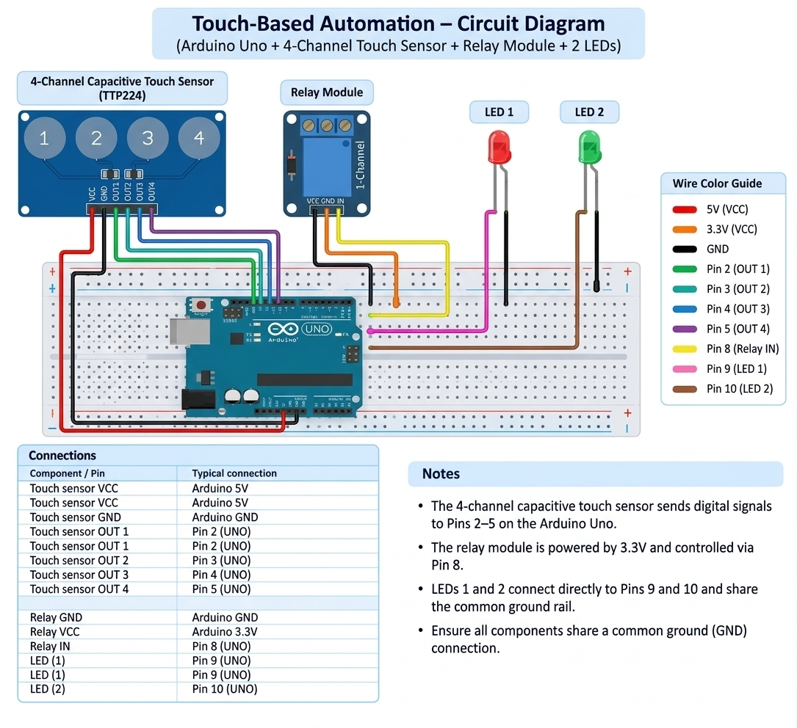

# Touch-Based Automation

## Aim

To control an electrical output, such as an LED, using a touch sensor.

## What is the project?

A touch-based automation system that uses a capacitive sensor as an input and a relay as an electrically controlled switch.

## How does it work?

1. The capacitive touch sensor detects a touch and sends a digital signal to the Arduino Uno.
2. The Arduino processes the signal according to its program.
3. The Arduino activates or deactivates the relay.
4. The relay switches the connected output circuit, such as an LED.
5. Depending on the code, touching may turn the output on, off, or toggle its state.

## Components used

- Arduino Uno
- Capacitive touch sensor
- Relay module
- 2 LEDs

## Circuit Diagram

## Connections

| Component / Pin | Typical connection |
|---|---|
| Touch sensor VCC | Arduino 5V |
| Touch sensor GND | Arduino GND |
| Touch sensor OUT 1 | Pin 2 (Arduino Uno) |
| Touch sensor OUT 2 | Pin 3 (Arduino Uno) |
| Touch sensor OUT 3 | Pin 4 (Arduino Uno) |
| Touch sensor OUT 4 | Pin 5 (Arduino Uno) |
| Relay GND | Arduino GND |
| Relay VCC | Arduino 3.3V |
| Relay IN | Pin 8 (Arduino Uno) |
| LED (1) | Pin 9 (Arduino Uno) |
| LED (2) | Pin 10 (Arduino Uno) |

## Important wiring notes

- The source document specifies relay VCC at 3.3V. Check the exact relay module's requirements before powering it; not all modules operate correctly at this voltage.
- Use an appropriate current-limiting resistor for each LED.
- The source does not specify the relay output-terminal connections. Check the module labels and use a low-voltage LED demonstration.
- This is a classroom electronics project. Do not connect the relay to mains electricity.
